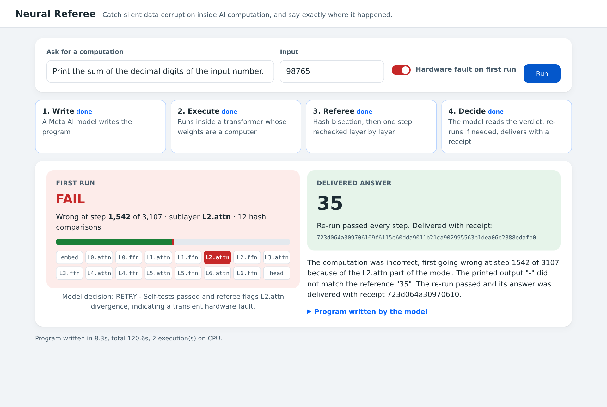

# Neural Referee

**Catch silent data corruption inside AI computation, and say exactly where it happened.**



Hardware sometimes computes a wrong value without raising any error. Meta (then Facebook) studied these
silent data corruptions and ran silent-error tests across hundreds of thousands of machines in its fleet
("Silent Data Corruptions at Scale", Dixit et al., arXiv 2102.11245): the CPU's own error reporting does not
catch them, and they surface later as application-level problems. As more computation moves inside models, the same question applies to the model: when a
step goes wrong, which step, and which part of the model?

Neural Referee answers that for computers that run inside transformer weights
(**Neural Computer = Compiled Layers + Neural State + Program Weights + Verifier**). Researchers now compile
real machines into weights (Percepta's WebAssembly transformer, QwenPU's RISC-V CPU inside a 4B open model)
and only check the final output. Here, Meta's Muse Spark 1.3 (Meta Model API) writes the program and its own
tests, the program runs inside a 7-layer transformer whose weights are a computer, and the referee checks
every step: it returns a receipt for the whole trace, or the first wrong step and the faulty sublayer. Muse
reads that verdict, re-runs or repairs, and only delivers answers that come with a passing receipt.

What it measured (CPU only, reproducible from this repo):
- **Stress test: no wrong answer delivered.** 12 tasks, every execution hit by 8 random bit flips. An
  unchecked pipeline delivered 4 wrong answers. The Muse agent loop delivered 0 wrong: 10 correct, each
  with a receipt, and 2 withheld because Muse could not write a working program (11 re-run decisions, all
  "retry" after a referee FAIL). `results/agent_stress.json`
- **Faults that weight checks cannot see.** Bit flips in activations or attention memory while the program
  runs: the referee located 30 of 30; comparing weight files located 0 of 30; an output-only check
  detected them but located none. Weight corruption: 15 of 15 here, 40 of 40 in two earlier runs.
- **Hidden errors.** In one run the final answer was right (35) but step 1,909 of 3,107 was computed
  wrongly in `L1.attn`. Output-only checking passes that run; the referee fails it.
- **Cheap to check.** About 11 hash comparisons find the first wrong step in a 3,000-step trace; one step
  is then rechecked layer by layer. No false alarms on four clean programs up to 44,332 steps.
- **Meta models in the loop.** Muse Spark 1.3 wrote correct programs for 9 of 10 requests on the first try
  (about 12 s each). A local open-weights Llama 3.2 3B runs the same loop offline (7 of 9).

What it does not claim: Muse was already right on 15 of 15 exact questions answered directly
(`results/muse_vs_verified.json`); the referee's value is that each answer comes with a checkable receipt
and that faults in the computer itself are caught and located, including ones that leave the answer
looking right.

Demo: `python demo/server.py` then open http://127.0.0.1:8765 (see "Run it").

Built for the Meta Global AI Developer Hackathon (Oct 26 - Nov 4, 2026), Indie track. All code in this
repository is new work from 2026-11-03.

## Hypothesis H-R
When a computer that runs inside transformer weights produces a wrong result, its own execution record
is enough to find the first wrong step and the faulty sublayer.
Pass rule, fixed before running: at least 9 of 10 harmful injected faults located exactly
(step equal to a full linear comparison, sublayer equal to where the corrupted weight lives).

## How it works
1. **Commit.** The prover (the neural computer, possibly faulty) runs a program and publishes a SHA-256
   hash chain over its token trace plus its residual activations after every sublayer.
   The reference executor (a plain WebAssembly interpreter) publishes a hash chain over its trace.
2. **Bisect.** The referee compares chain values at O(log n) indices to find the first step k where the
   traces differ (about 10-14 comparisons for 1,000-9,000-step traces).
3. **Recheck one step.** At the position that produced step k, the referee recomputes every sublayer
   (embedding, attention and FFN of each layer, output head) with the golden compiled weights from the
   prover's committed inputs. The first sublayer whose committed output differs is the faulty one.
4. **Earlier-position scan (fallback).** If every sublayer at step k is consistent, the fault changed an
   earlier position whose state later reached step k through attention. The referee checks every
   sublayer at all earlier positions in one parallel pass per sublayer and reports the earliest
   inconsistent position and sublayer.

## Results (CPU only, no GPU)

### 1. Referee vs baselines on three fault classes (`results/baseline_table.json`, seed 7)
15 harmful faults per class (faults that changed nothing in the trace are counted separately and skipped).

| Fault class | What breaks | Output-only check (what transformer-vm / QwenPU report) | Weight-file diff | **Referee** |
|---|---|---|---|---|
| weight | one corrupted weight | detects 15/15, locates 0/15 | locates 15/15 | **locates 15/15** |
| act | one bit flipped in a residual during execution (compute error) | detects 15/15, locates 0/15 | **locates 0/15** (weights are fine) | **locates 15/15** (exact position 15/15) |
| kv | one bit flipped in attention memory during execution | detects 15/15, locates 0/15 | **locates 0/15** | **locates 15/15** (right sublayer; reports the first step that read the bad memory, exact write position 4/15) |

Most single bit flips are harmless: 16 of 31 weight faults, 170 of 185 compute faults and 285 of 300
memory faults left the trace unchanged, and the referee reports PASS for those.

### 2. Fault localization, weight faults only (H-R test)
| Run | Harmful faults | Located exactly | Found at step k | Needed scan | Benign | Referee time / prover time |
|---|---|---|---|---|---|---|
| `results/h_r_stratified.json` (seed 2, faults spread over 16 sublayers) | 20 | 20 | 18 | 2 | 27 | 0.149 |
| `results/h_r_stratified_seed3.json` (seed 3) | 20 | 20 | 15 | 5 | 20 | 0.194 |
| `results/h_r.json` (seed 1, sampled by tensor size, 6 of 10 in the head) | 10 | 10 | - | - | 13 | - |

No false alarms: the unmodified model passes `hello`, `addition`, `fibonacci` and `collatz`
(1,034 to 44,332 steps).

### 3. Hidden errors
A runtime fault can corrupt a step without changing the final answer. In `results/demo_muse.json` the
program printed the correct `35`, yet step 1,909 of 3,107 was computed wrongly in `L1.attn`. An
output-only check passes this run; the referee fails it and names the step and sublayer.

### 4. Stress test: Muse agent loop on a faulty machine (`results/agent_stress.json`)
Every execution on the transformer computer is hit by 8 random bit flips in activations or attention
memory. The agent writes the program and 3 self-tests, runs, reads the referee verdict, re-runs on FAIL and
delivers only answers with a passing receipt.

| 12 tasks (letter counts, 30-digit digit sums, 20-digit sums, Collatz steps) | Wrong delivered | Correct delivered | No answer |
|---|---|---|---|
| Unchecked pipeline (first output) | 4 | 6 | 2 |
| Muse agent loop with referee | **0** | 10 | 2 |

21 executions in total, 11 referee FAILs, 11 "retry" decisions by Muse. One FAIL had the right printed
answer but a wrong step inside, which only the referee could see. The 2 withheld tasks were 20-digit sums
where Muse's program did not compile, so neither path produced an answer for them. The first run of the Collatz group used n < 1000; the model's program
halves by repeated subtraction (division is not allowed), giving an 11.3M-step trace that exhausted RAM, so
the group was rerun with n in 5..40 and the agent now refuses traces above 200,000 steps.

### 5. Meta models as the front end (`results/accuracy_muse.json`, `results/llama_accuracy.log`)
10 fixed plain-language requests; a program counts as correct when its output on the plain WebAssembly
reference equals the expected output. Wrong output or compile/run errors are fed back (up to 3 rounds).

| Model | First try correct | Correct within 3 rounds | Time per request |
|---|---|---|---|
| Muse Spark 1.3 (Meta Model API) | 9/10 | 9/10 | about 12 s |
| Llama 3.2 3B Instruct (open weights, local CPU) | 7/9 | 7/9 | about 6 min |

The one Muse miss (sum of 1..n) is a correct C loop that clang -O2 rewrote into a closed form using
64-bit multiply, an opcode transformer-vm does not implement. The local Llama run stopped on the same
case. Muse's verdict explanations were also factually consistent; the 3B model contradicted itself on
whether the outputs matched. Total Muse cost for the demo and the 10-request test: about 0.17 USD.

## Honest limits
- The method (hash bisection plus one-step re-execution) follows Verde (Gensyn, arXiv 2502.19405); the
  new part is applying it to computers compiled into transformer weights, where state lives in attention
  history and a fault can reach the wrong step from an earlier position.
- The referee needs the golden compiled weights. For compiled (not trained) layers this is cheap: the
  compiler output is deterministic and can be rebuilt by anyone.
- Recomputing one attention sublayer still reads keys at all earlier positions (no autoregressive
  generation). Measured referee time is 15-19% of the prover's run time, not 1%.
- Bug found and fixed during the work: the earlier-position scan first recomputed in batches, which rounds
  differently from the prover's one-vector-at-a-time arithmetic and gave 156 false mismatches on a clean
  run. It now uses identical per-vector operations (0 mismatches).
- Tested only on transformer-vm (7 layers, d_model 38). QwenPU needs a 40 GB GPU and was not run.

## Run it
```
# 1. transformer-vm (Apache-2.0) in a sibling folder, with a clang that has the wasm32 target
git clone https://github.com/Percepta-Core/transformer-vm ../_ext/transformer-vm
cd ../_ext/transformer-vm && uv sync && CLANG_PATH=<clang with wasm32> uv run wasm-run   # builds model.bin
# 2. this repo, using that environment
export TVM_ROOT=../_ext/transformer-vm
PYTHONPATH=. $TVM_ROOT/.venv/bin/python -m pytest tests -q
PYTHONPATH=. $TVM_ROOT/.venv/bin/python experiments/h_r.py --n 20 --seed 2 --stratify
```
No GPU or API key is needed for the referee.

Meta model front end (program writing, verdict explanation):
```
export META_MODEL_API_KEY=...          # Meta Model API key from dev.meta.ai -> uses muse-spark-1.3
# or leave it unset: open-weights Llama 3.2 3B GGUF via llama.cpp (pip install llama-cpp-python),
#   path from LLAMA_GGUF (default ../_ext/models/Llama-3.2-3B-Instruct-Q4_K_M.gguf)
export CLANG_PATH=<clang with wasm32>
PYTHONPATH=. $TVM_ROOT/.venv/bin/python demo/run_demo.py "print the sum of the decimal digits of the input number" \
    --input 98765 --expect 35 --fault act:pos=1908,sublayer=3,dim=3,bit=59
PYTHONPATH=. $TVM_ROOT/.venv/bin/python experiments/baseline_table.py --n 15 --seed 7
PYTHONPATH=. $TVM_ROOT/.venv/bin/python experiments/llama_accuracy.py
```

## Layout
- `referee/tvm.py` - prover run with activation commitments; golden recompute of one sublayer
- `referee/protocol.py` - hash chain, bisection, one-step recheck, earlier-position scan
- `referee/faults.py` - weight fault injection with the true sublayer recorded
- `referee/baselines.py` - weight-file diff and output-only baselines
- `referee/llama_front.py` - Meta model front end (Muse via Meta Model API, or local Llama)
- `demo/run_demo.py` - request -> program -> neural computer -> referee -> explanation (CLI)
- `demo/server.py`, `demo/web/index.html` - one-page web demo
- `demo/record_video.py` - records the 3-minute demo video from the web demo
- `experiments/h_r.py` - the H-R test
- `experiments/baseline_table.py` - referee vs baselines on weight, compute and memory faults
- `experiments/llama_accuracy.py` - program-writing accuracy of the Meta model front end
